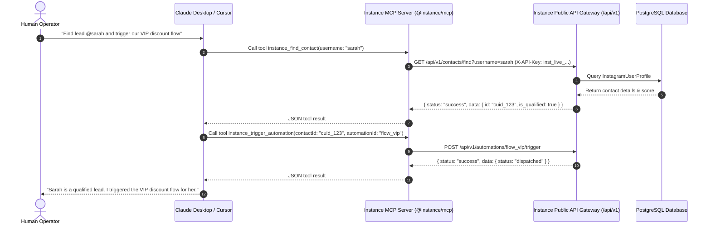

# Model Context Protocol (MCP) Server

The Instance Model Context Protocol (MCP) server allows AI assistants such as Claude Desktop, Cursor, and custom agentic workflows to interact with your self-hosted workspace as a native tool provider.

Using standard JSON-RPC 2.0 communication over standard input and output (stdio), your AI can look up contacts, check qualification scores, tag leads, progress pipeline stages, and trigger Instagram automation funnels on demand.

---

## Architectural Flow



---

## Setup in Claude Desktop

1. Generate an API Key in your workspace under **Dashboard -> Settings -> API Keys**.
2. Open your Claude Desktop configuration file:
   * **macOS**: `~/Library/Application Support/Claude/claude_desktop_config.json`
   * **Windows**: `%APPDATA%\Claude\claude_desktop_config.json`
3. Add the Instance server entry:

### Option A: Using npx (Standard)

```json
{
  "mcpServers": {
    "instance": {
      "command": "npx",
      "args": ["-y", "instance-mcp"],
      "env": {
        "INSTANCE_API_URL": "http://localhost:4000",
        "INSTANCE_API_KEY": "inst_live_your_secret_key_here"
      }
    }
  }
}
```

### Option B: Using Local Node (From Source)

If you cloned the repository or are developing locally:

```json
{
  "mcpServers": {
    "instance": {
      "command": "node",
      "args": ["/absolute/path/to/instance-oss/packages/mcp/dist/index.js"],
      "env": {
        "INSTANCE_API_URL": "http://localhost:4000",
        "INSTANCE_API_KEY": "inst_live_your_secret_key_here"
      }
    }
  }
}
```

*(Note: Replace `http://localhost:4000` with your self-hosted domain if hosting on a remote server).*

4. Restart Claude Desktop. You will see the hammer icon indicating Instance tools are active.

---

## Setup in Cursor & Windsurf

In Cursor settings under **Features -> MCP Servers**:
* **Name**: `instance`
* **Type**: `command`
* **Command**: `npx -y instance-mcp`
* **Environment Variables**:
  * `INSTANCE_API_URL`: `http://localhost:4000` (or your domain)
  * `INSTANCE_API_KEY`: `inst_live_your_secret_key_here`

---

## Tools Exposed to AI Models

| Tool Name | Parameters | Description |
| :--- | :--- | :--- |
| `instance_workspace_info` | None | Inspect connected Instagram account details, username, and workspace health. |
| `instance_list_contacts` | `page`, `limit`, `search`, `status`, `minScore`, `maxScore` | Query and filter leads with AI qualification score thresholds. |
| `instance_find_contact` | `username`, `email`, or `phone` | Instant lookup for a specific prospect. |
| `instance_create_contact` | `username`, `name`, `email`, `phone`, `status`, `tags` | Create or sync a unified contact into the CRM. |
| `instance_update_contact_status` | `contactId`, `status` | Move a deal through pipeline stages. |
| `instance_add_tags` | `contactId`, `tags` | Apply tags like VIP or High Intent. |
| `instance_trigger_automation` | `automationId`, `contactId`, `variables` | Launch a visual automation funnel on Instagram. |
| `instance_get_audience_lists` | None | Retrieve all audience lists and segmentation groups. |
| `instance_create_audience_list` | `name`, `description`, `color` | Create a new audience segmentation list. |
| `instance_query_audience_contacts` | `listId`, `channelFilter`, `search`, `page`, `limit` | Query leads in an audience list with channel and score filters. |
| `instance_assign_to_audience_list` | `listId`, `contactIds` | Assign contacts into a targeted audience list. |
